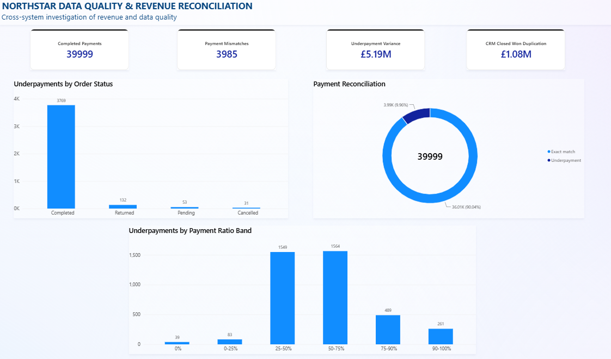
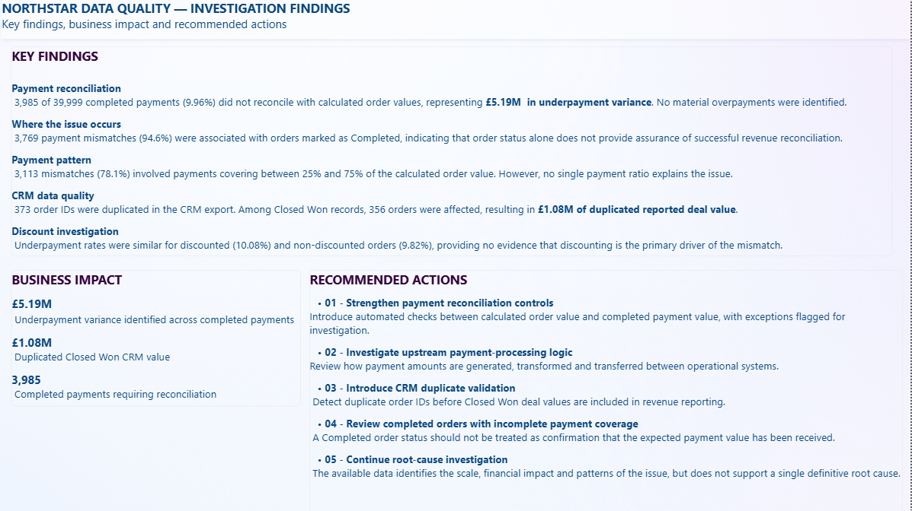

# Northstar Data Quality Investigation

**SQL | Power BI | Data Quality | Revenue Reconciliation | Root Cause Analysis**

---

## Dashboard Preview

The Power BI report summarises the results of a cross-system data quality and revenue reconciliation investigation, highlighting financial discrepancies, CRM duplication and areas requiring further investigation.

### Executive Summary



*Executive dashboard presenting payment reconciliation results, financial impact, CRM duplication and underpayment patterns.*

---

### Investigation Findings



*Summary of key findings, business impact and recommended actions resulting from the investigation.*

---

## Overview

This project demonstrates an end-to-end data quality investigation across multiple operational systems using SQL and Power BI.

The objective was to determine whether revenue-related records were consistent across orders, payments, refunds and CRM data, quantify the financial impact of identified discrepancies, investigate potential causes and communicate the results through an executive Power BI report.

Rather than focusing only on dashboard creation, the project follows an investigative approach: validating source data, reconciling records across systems, testing possible explanations for anomalies and distinguishing between findings supported by the data and areas requiring further investigation.

---

## Business Context

Organisations often rely on multiple operational systems to manage different stages of the same business process.

Orders may be recorded in one system, payments processed in another, refunds maintained separately and sales activity reported through a CRM platform.

When these systems are not fully aligned, organisations may experience:

- inconsistent revenue reporting
- incomplete or incorrect payment records
- duplicated CRM values
- unreliable management information
- difficulty identifying the source of financial discrepancies
- reduced confidence in reported KPIs

This project simulates a cross-system investigation designed to identify and quantify these risks.

---

## Investigation Objectives

The investigation aimed to:

- validate the completeness and structure of the source data
- reconcile completed payments against calculated order values
- identify payment mismatches and quantify their financial impact
- investigate whether mismatches were associated with order status
- test whether discounting could explain the discrepancies
- analyse payment-to-order value ratios for recurring patterns
- identify duplicated CRM records and quantify duplicated deal value
- evaluate refund activity across order statuses
- develop an executive Power BI report
- provide business recommendations based on the evidence

---

## Dataset

The investigation uses five related operational tables:

| Table | Records | Purpose |
|---|---:|---|
| Customers | 1,800 | Customer reference data |
| Orders | 42,000 | Order value, quantity, discount and status |
| Payments | 40,986 | Payment amount and payment status |
| Refunds | 2,197 | Refund transactions |
| CRM Export | 41,880 | CRM deal values and deal status |

The tables represent different stages of the same commercial process, allowing cross-system reconciliation and data quality testing.

---

## Tools & Technologies

- SQL Server
- SQL Server Management Studio (SSMS)
- SQL
- Power BI
- Power Query
- DAX
- Data Validation
- Data Reconciliation
- Root Cause Analysis
- Data Visualisation
- Business Reporting

---

## Investigation Approach

The project followed a structured investigation process:

1. Database Setup
2. Data Validation
3. Cross-System Record Checks
4. Revenue Reconciliation
5. Payment Variance Analysis
6. Refund Analysis
7. CRM Duplicate Investigation
8. Hypothesis Testing
9. Power BI Reporting
10. Business Recommendations

This approach was designed to move from identifying anomalies to understanding their scale, business impact and possible causes.

---

## Data Validation

Initial SQL validation was performed to confirm table volumes, data types and record consistency before beginning financial reconciliation.

Key validation activities included:

- checking record counts across all source tables
- reviewing payment and order status distributions
- validating financial fields
- checking relationships between orders and payments
- reviewing refund activity
- identifying duplicate CRM order IDs

Financial fields used in reconciliation were stored using decimal precision to ensure reliable financial calculations.

---

## Revenue Reconciliation

For each order, the expected order value was calculated using:

```text
Order Value = Quantity × Unit Price × (1 − Discount)
```

Completed payment values were then compared with calculated order values.

A tolerance of **±£0.01** was used to distinguish valid matches from material reconciliation differences.

Payments were classified as:

- Exact Match
- Underpayment
- Overpayment

The reconciliation identified a significant population of completed payments that did not match the expected order value.

---

## Key Findings

### Payment Reconciliation

**39,999** completed payments were analysed.

Of these:

- **36,014 (90.04%)** reconciled with calculated order values
- **3,985 (9.96%)** did not reconcile
- no material overpayments were identified

The mismatched payments represented approximately:

**£5.19M in underpayment variance**

---

### Mismatches by Order Status

The majority of payment mismatches were associated with orders marked as Completed.

| Order Status | Underpayments |
|---|---:|
| Completed | 3,769 |
| Returned | 132 |
| Pending | 53 |
| Cancelled | 31 |

Approximately **94.6% of all identified underpayments were associated with Completed orders**.

This indicates that an order being marked as Completed does not necessarily confirm that the expected payment value has been received.

---

### Payment Ratio Analysis

Payment-to-order value ratios were analysed to determine whether underpayments followed a consistent pattern.

| Payment Ratio | Underpayments |
|---|---:|
| 0% | 39 |
| 0–25% | 83 |
| 25–50% | 1,549 |
| 50–75% | 1,564 |
| 75–90% | 489 |
| 90–100% | 261 |

**3,113 mismatches (78.1%)** involved payments covering between **25% and 75%** of the calculated order value.

However, the distribution does not indicate a single payment ratio responsible for the issue.

---

### Discount Investigation

Discounting was tested as a possible explanation for the reconciliation differences.

Underpayment rates were:

- **10.08%** for discounted orders
- **9.82%** for non-discounted orders

The similarity between these rates provides no evidence that discounting is the primary driver of the payment mismatches.

---

### CRM Data Quality

The CRM export contained:

**373 duplicated order IDs**

Further investigation of Closed Won records identified:

- **356 affected Closed Won orders**
- approximately **£1.08M in duplicated reported deal value**

This creates a risk that CRM-based revenue reporting may overstate commercial performance if duplicate records are not identified before aggregation.

---

## Refund Analysis

Refund activity was also reviewed to understand whether refunds could explain differences between operational order status and realised revenue.

Returned orders showed substantial refund activity, as expected.

However, completed orders also contained refund records, reinforcing the importance of reconciling financial transactions rather than relying exclusively on operational order status when reporting revenue.

---

## Root Cause Investigation

Several hypotheses were tested to determine whether the payment mismatches could be explained by a single observable factor.

The investigation considered:

- order status
- discount usage
- payment-to-order value ratios
- refund activity

The analysis identified clear patterns in where the discrepancies occur, but none of the tested variables provides a complete explanation for the issue.

The available data therefore supports identification of the **scale, location and financial impact** of the problem, but does not support a definitive single root cause.

Further investigation should focus on upstream payment-processing logic and the way payment values are generated, transformed and transferred between operational systems.

---

## Power BI Dashboard

The Power BI report was designed to communicate both the scale of the issue and the outcome of the investigation.

### Executive Summary

The first report page includes:

- Completed Payments
- Payment Mismatches
- Underpayment Variance
- CRM Closed Won Duplication
- Underpayments by Order Status
- Payment Reconciliation
- Underpayments by Payment Ratio Band

### Investigation Findings

The second report page summarises:

- key investigation findings
- financial and operational business impact
- recommended actions
- limitations of the available data
- areas requiring further investigation

---

## Business Impact

The investigation identified two significant reporting risks:

### £5.19M Underpayment Variance

Completed payment records contained approximately **£5.19M less than the calculated value of the associated orders** across identified mismatches.

### £1.08M CRM Duplication

Duplicate Closed Won CRM records resulted in approximately **£1.08M of duplicated reported deal value**.

Together, these findings demonstrate how data quality issues across operational systems can materially affect revenue reporting and management information.

---

## Business Recommendations

Based on the investigation, the following actions are recommended:

### 1. Strengthen Payment Reconciliation Controls

Introduce automated checks between calculated order value and completed payment value, with exceptions automatically flagged for investigation.

### 2. Investigate Upstream Payment-Processing Logic

Review how payment amounts are generated, transformed and transferred between operational systems.

### 3. Introduce CRM Duplicate Validation

Detect duplicate order IDs before Closed Won deal values are included in revenue reporting.

### 4. Review Completed Orders with Incomplete Payment Coverage

A Completed order status should not be treated as confirmation that the expected payment value has been received.

### 5. Continue Root Cause Investigation

The available data identifies the scale, financial impact and patterns of the issue, but additional upstream system information would be required to establish a definitive root cause.

---

## Repository Structure

```text
northstar-data-quality-investigation
│
├── sql
│   ├── 01_database_setup.sql
│   ├── 02_data_validation.sql
│   └── 03_revenue_reconciliation.sql
│
├── power_bi
│   └── Northstar_Data_Quality_Investigation.pbix
│
├── images
│   ├── executive_summary.png
│   └── investigation_findings.png
│
└── README.md
```

---

## Project Files

| Resource | Description |
|---|---|
| [Database Setup](sql/01_database_setup.sql) | Database and table setup used for the investigation |
| [Data Validation](sql/02_data_validation.sql) | Data quality checks and cross-system validation |
| [Revenue Reconciliation](sql/03_revenue_reconciliation.sql) | Payment reconciliation, variance analysis and investigation queries |
| [Power BI Report](power_bi/Northstar_Data_Quality_Investigation.pbix) | Interactive Power BI investigation report |

---

## Skills Demonstrated

- SQL
- Power BI
- DAX
- Power Query
- Data Quality Analysis
- Financial Data Reconciliation
- Cross-System Analysis
- Data Validation
- Root Cause Investigation
- Hypothesis Testing
- Data Visualisation
- Executive Reporting
- Business Impact Analysis
- Business Recommendations

---

## About This Project

This project demonstrates my ability to investigate complex data quality issues across multiple operational systems rather than simply report existing KPIs.

It combines SQL-based validation and reconciliation with hypothesis testing, financial impact analysis and Power BI reporting to identify where data discrepancies occur, quantify their business impact and determine what the available evidence can - and cannot - explain.

The project also demonstrates an evidence-based approach to root cause investigation: potential explanations were tested against the data rather than assumed, and where the available information was insufficient to establish a definitive cause, this limitation was clearly identified.
